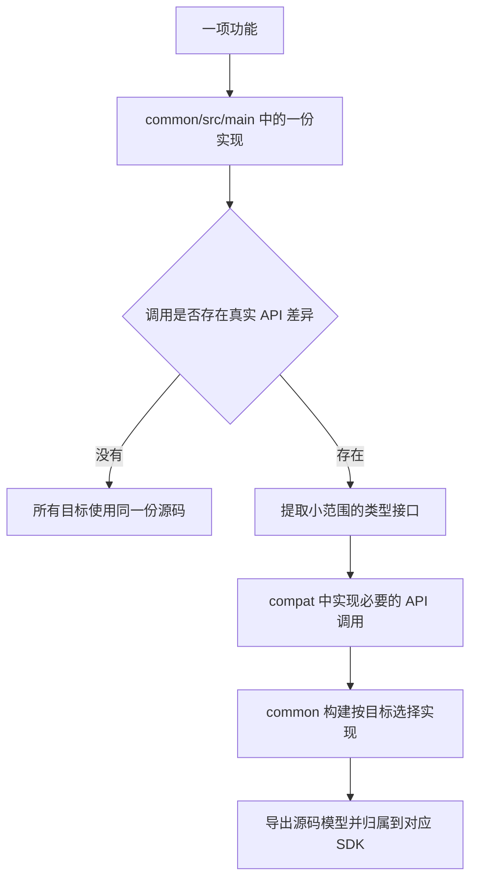

# 源码归属与目录规则

[English](source-layout.en.md)

开发主要围绕 `common` 和 `targets`。`common` 保存游戏实现和共享依赖；`targets` 保存各组合的独立构建。目录先按编译环境分层，Java 包再按业务职责分类。版本号不是业务分类，`compat` 也不是杂物目录。

## 一份功能放在哪里

算法、业务规则、状态、配置语义、资源处理流程留在 `main`。差异层只实现经过对应版本源码确认的 API、类型和生命周期差异。不能因为导入或几次方法调用不同，就复制整份业务类。相同版本的多个 Loader 共用版本适配，相同 Loader 的多个版本共用仍然适用的 Loader 适配。

## 编译层

| 目录 | 内容 | 接入条件 |
| --- | --- | --- |
| `common/src/main/java` | 通用实现、接口与契约 | 所有目标 |
| `common/src/main/resources` | 共享手写资源 | 所有目标 |
| `common/src/compat/minecraft/<mc>/java` | Minecraft API 差异 | 对应 Minecraft 的目标 |
| `common/src/compat/<loader>/java` | Loader 入口和 API 差异 | 对应 Loader 的目标 |
| `common/src/compat/<loader>/<mc>/java` | 两种条件共同决定的差异 | 对应 Loader / Minecraft 组合 |
| 上述适配层的 `resources` | 该条件下必要的资源或配置 | 与该源层相同 |
| `common/src/test` | 共享模块的测试源码与资源 | 测试源集，不属于生产源码归属清单 |
| `targets/<loader>-<mc>` | 构建、Wrapper、元数据、运行和发布配置 | 一个组合一个独立 Gradle 根 |
| `targets/<loader>-<mc>/src/generated/resources` | 该目标的 DataGen 输出 | 由实际 provider 和任务维护 |

表中前三种适配路径由默认构建直接支持。需要跨多个版本复用同一 API 实现时，可以在 `compat` 内按领域、能力和 API 代际继续分类，例如 `minecraft/registry/holder/java`。这类目录必须在 `common/build.gradle(.kts)` 中明确选择，写清适用条件，并进入实际的 `templeSourceDirectories` / `templeResourceDirectories`。新建目录本身不会接入构建。不要为了套用版本目录而复制相同适配文件，也不要递归合并所有 `java` 目录。

自定义源层仍须位于 `common/src`。每个非空生产目录至少有一个已配置目标使用。同名类的不同实现必须由互斥条件选择，同一目标只能编译其中一个。暂未接入的分支不算已支持；先向维护者说明用途，再决定接入、保留位置或清退，不能擅自新增版本、删除源码或给它随意指定 SDK。

新建工程只在生产目录保留所选 Loader 的适配源码。未选 Loader 的文件移入 `gradle/target-blueprints/common/<loader>`，以 `.template` 作为文件后缀；它们是后续新增目标使用的源蓝图，不属于 Java 编译或 IDE 源码根。添加该 Loader 的目标时，文件回到 `common/src/compat/<loader>`，不覆盖内容不同的现有文件。两种新建入口采用同一规则，复用工程创建新项目时也会更新蓝图中的 Java 包名。

复用工程时，当前目标为对应文件提供蓝图，其他已有蓝图文件继续保留。同一输出路径只复制一次；生产源码与蓝图中的 Java 包名使用同一转换规则。

## Java 包按职责分类

下表的路径相对于实际 Java 基础包。只建立已经需要的包，同一职责的少量类可以放在一起。

| 职责 | 包路径示例 | 边界 |
| --- | --- | --- |
| 注册 | `registry/item`、`registry/block`、`registry/entity` | 分类注册入口，不塞入业务实现 |
| 方块与物品 | `block/<功能>`、`item/<功能>` | 对应行为、组件与交互 |
| 实体 | `entity/passive`、`entity/hostile`、`entity/boss/<种类>` | 行为与状态；渲染放到 client |
| 方块实体与菜单 | `blockentity/<功能>`、`menu/<功能>` | 服务端行为、存储和同步 |
| 指令 | `command/<功能>`、`command/argument/<类型>` | 命令注册、参数和执行 |
| 网络 | `network/payload/<功能>`、`network/handler/<功能>` | 消息定义与处理，不存放其他配置 |
| 配置与存档 | `config/<功能>`、`storage/<数据领域>` | 配置语义与数据持久化分开 |
| 世界 | `world/biome`、`world/feature`、`world/structure` | 生成、放置与世界行为 |
| 客户端渲染 | `client/renderer/entity`、`client/renderer/blockentity` | 对应渲染器及其接入 |
| 客户端界面 | `client/screen/<功能>`、`client/input`、`client/i18n` | 界面、输入与本地化分别组织 |
| 客户端表现 | `client/model`、`client/particle`、`client/sound` | 模型、粒子与声音各自归属 |
| 数据生成 | `data/recipe`、`data/loot`、`data/tag`、`data/worldgen` | 按 provider 的资源职责组织 |
| Mixin | `mixin/<被修改的领域>` | 注入点与配置同步维护 |
| 可选模组兼容 | `compat/<依赖>/<功能>` | 与构建源层 `src/compat` 区分；隔离可选类型的加载 |

包名不要求机械套用表格；它必须能说明类实际负责的工作。不能把不同职责堆在基础包、单个 `client` 包或 `manager`、`util`、`misc` 中，也不能仅靠文件名前缀分类。Loader 主入口、公共初始化入口和生成的 `BuildInfo` 可以保留框架约定的位置；入口只负责接线，不演变成配置、网络、渲染和注册合在一起的大类。

差异实现保留相同的职责层级。例如公共接口在 `client/screen/config`，其版本实现仍放在对应适配 Java 根下的 `client/screen/config`。移动类时同步修改 package、导入、入口、注册、Mixin 配置及资源引用。

## 资源、依赖与构建代码

- 手写资源使用 `resources/assets/<modid>/{lang,textures,models,blockstates,...}` 和 `resources/data/<modid>/...`；保留编辑器资源和已有 provider 的维护方式。
- Loader 元数据、AT、AW / ClassTweaker、Mixin 配置留在对应资源层的规范路径。客户端资源和服务端数据各自分类。
- 共享库依赖在 `common/build.gradle(.kts)` 使用 `api`、`implementation`、`compileOnly`、`runtimeOnly` 声明。仅某目标需要的依赖留在目标配置中。
- Gradle 构建约定、IDEA 扩展、向导资产和发布工具留在各自的 `gradle` / `buildSrc` / `integrations` 目录，不混进游戏源码或发行 JAR。

## 模型与目录归属

每个目标配置后，在 `common/.gradle/contexts/<target>/ide-sources.json` 导出实际源层。模型同时记录编辑目标、标准构建输入的摘要和生产源码／资源目录清单。扩展据此识别过期数据；修改构建脚本、增加或迁移源码目录后需要重新同步全部目标。旧 schema 的模型也须重新同步，不能仅安装新 ZIP 后沿用旧缓存。

模型缺失、过期、无效或模块尚未导入时，扩展列出受影响目标，并保留上一次完整归属。所有模型就绪后，才分配源码所有者并列出没有目标使用的目录。每个物理目录只有一个 IDE 所有者；其他目标引用该所有者。SDK 来自真正使用该目录的目标，不能把互斥实现全部标成当前 common 的源码。

根任务 `verifySourceLayout` 读取已有模型，列出每个目标的 Java / 资源根；遇到过期模型、无归属目录或同一目标中的重复 Java 路径时失败。该任务不会自动同步、构建游戏或选择 SDK。它检查构建归属，不能判断一个业务类的职责是否合理；包分类、初始化和调用链仍须阅读源码确认。

文件类型以实际源码根为准。Java 包可以含 `resources`，资源子目录也可以叫 `java`；这些名字不会改变其归属。Java 根下的非 Java 文件不会自动变成资源，需要放进实际资源集。

## 开发与迁移的完成条件

每次新增或迁移文件，先确认它的业务职责、目标范围、源码根和实际消费者，再修改实现。任务结束时必须满足：

1. 通用逻辑只维护一份，差异层中的每个类都有实际 API 差异和消费者。
2. 所有非空生产目录都被目标选择；自定义能力层有明确条件，同名实现互斥。
3. 每个文件进入对应职责的包和资源目录，入口、引用、注册、访问配置及生成链路同步更新。
4. 全部目标和 common 使用真实 Gradle 模型；补全、跳转、发行包和运行证据按实际验收范围分别确认。
5. 迁移不残留并行的 `versions`、`loaders` 或旧工程壳；清退前核对文件归属，保留用户数据和不属于本次任务的改动。

先完成生产改动，再按约定集中验收。源码迁移、模型归属、包分类和游戏行为是不同判据，不能用其中一项替代其他项。
